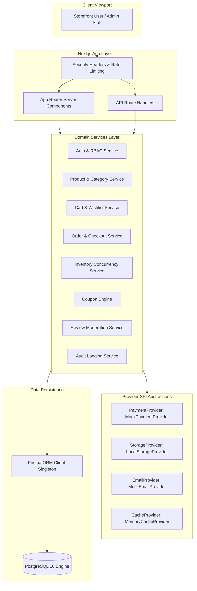
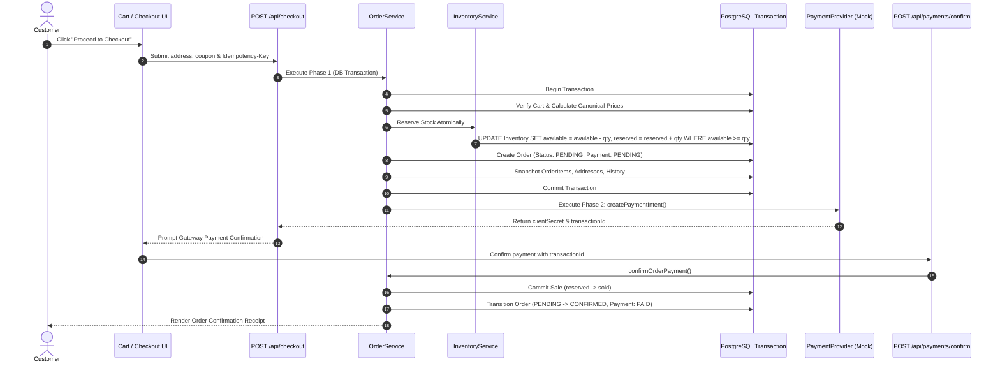

# System Architecture & Technical Design

## 1. Architectural Philosophy

Al-Zara Hub is built as a high-performance, domain-driven **Modular Monolith**. While microservices introduce distributed network latency, distributed transactions, and infrastructure hosting overhead (violating the zero-cost requirement), a clean modular monolith offers:

- **Strict Domain Boundaries**: Grouped by bounded context in `src/features/<domain>/`
- **Low-Latency In-Process Calls**: Domain services communicate in-process without network serialization overhead.
- **Provider SPI Abstraction**: Cross-cutting concerns (payment, storage, email, caching, rate limiting) are defined via interfaces (`src/lib/*`), allowing drop-in replacement with cloud services or free open-source adapters without modifying business logic.
- **Single-Deployment Simplicity**: Deployed as a single unified Next.js App Router artifact to free serverless hosting tiers.



---

## 2. Request & Execution Flows

### 2.1 Customer Checkout Request Flow



---

## 3. Directory Layout & Layer Responsibilities

```
src/
├── app/                  # Next.js Presentation Layer
│   ├── (store)/          # Storefront customer views (SSR & Client Components)
│   ├── admin/            # SaaS administrative console (RBAC protected)
│   └── api/              # Public & Admin REST Route Handlers
├── features/             # Domain Logic Layer (Modular Monolith)
│   ├── auth/             # Authentication & session services
│   ├── products/         # Catalog search, filtering & specs
│   ├── categories/       # Taxonomy & hierarchical tree queries
│   ├── cart/             # Guest and authenticated cart operations
│   ├── wishlist/         # Saved merchandise & move-to-bag
│   ├── orders/           # Lifecycle state machine & snapshots
│   ├── inventory/        # Concurrency locks & warehouse stock
│   ├── coupons/          # Promotional discount rules engine
│   ├── reviews/          # Verified ratings & moderation
│   ├── admin/            # Aggregate analytical queries
│   └── audit/            # Administrative change logs
├── lib/                  # Infrastructure & Cross-Cutting Concerns
│   ├── auth/             # Argon2id password hashing & jose JWT sessions
│   ├── db/               # Prisma singleton with connection pooling
│   ├── payments/         # PaymentProvider interface & Mock provider
│   ├── storage/          # StorageProvider interface & Local provider
│   ├── email/            # EmailProvider interface & Mock provider
│   ├── rate-limit/       # In-memory sliding window rate limiter
│   ├── cache/            # TTL in-memory caching provider
│   └── errors/           # Custom domain AppError classes & handlers
└── components/           # Reusable UI Component Library
    ├── ui/               # Primitive controls (Button, Input, Card, Badge)
    ├── storefront/       # Header, Footer, ProductCard, Gallery, Reviews
    └── shared/           # ThemeProvider, ThemeToggle
```
