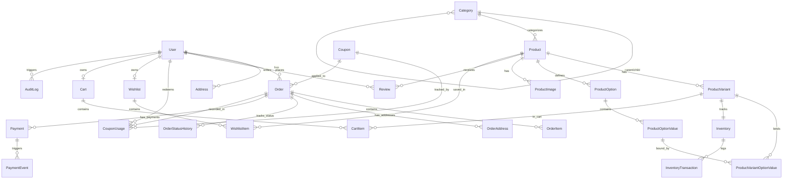

# Database Architecture & Relational Modeling

## 1. Relational Entity Relationship Diagram (ERD)



---

## 2. Table Schemas & Key Design Choices

### 2.1 Currency & Pricing Precision
- All prices, subtotals, tax rates, and discount values use PostgreSQL `DECIMAL(10, 2)` (and `DECIMAL(5, 4)` for tax rates) rather than floating-point numbers to eliminate floating-point rounding errors in financial transactions.

### 2.2 Historical Immutability (Snapshot Pattern)
- In `OrderItem` and `OrderAddress`, critical fields (`productName`, `variantSku`, `variantTitle`, `unitPrice`, `taxAmount`, `discountAmount`, `totalAmount`) are stored as immutable point-in-time snapshots.
- If an admin edits a product's price, deletes a variant, or alters a SKU months later, historical customer invoices and revenue accounting remain 100% accurate.

### 2.3 Concurrency Control & Inventory State
- `Inventory` separates:
  - `availableQuantity`: Units unreserved and purchasable.
  - `reservedQuantity`: Units held during active checkouts (15-minute hold).
  - `soldQuantity`: Units finalized through confirmed payment.
- Stock changes are tracked with immutable `InventoryTransaction` rows (`PURCHASE`, `SALE`, `RESERVATION`, `RELEASE`, `ADJUSTMENT`, `RESTOCK`).

---

## 3. Database Indexes & Query Performance Rationale

| Table | Index Columns | Type | Architectural Rationale |
|---|---|---|---|
| `User` | `[email]` | UNIQUE | High-frequency login lookup; enforces single account per email. |
| `User` | `[role]` | B-Tree | Speeds up admin dashboard queries filtering staff vs customers. |
| `Category` | `[slug]` | UNIQUE | Instant O(1) route lookups for category URLs. |
| `Category` | `[parentId]` | B-Tree | Accelerates recursive hierarchical tree lookups. |
| `Product` | `[slug]` | UNIQUE | Fast lookup for `/products/[slug]`. |
| `Product` | `[categoryId]` | B-Tree | Essential for category page product listings. |
| `Product` | `[status]` | B-Tree | Eliminates table scans when filtering out DRAFT/ARCHIVED merchandise. |
| `Product` | `[basePrice]` | B-Tree | Accelerates price range sorting (`price-asc`, `price-desc`). |
| `Product` | `[ratingAverage]` | B-Tree | Optimizes "Highest Rated" and "Featured" sorting. |
| `ProductVariant` | `[sku]` | UNIQUE | Global unique inventory identifier. |
| `Inventory` | `[variantId]` | UNIQUE | 1:1 foreign key joining variant to stock. |
| `Inventory` | `[availableQuantity]` | B-Tree | Fast lookup for "Low Stock" alerts (≤ 5 units). |
| `CartItem` | `[cartId, variantId]` | UNIQUE | Prevents duplicate cart line items for identical variants. |
| `WishlistItem` | `[wishlistId, productId, variantId]` | UNIQUE | Prevents duplicate wishlist entries. |
| `Order` | `[orderNumber]` | UNIQUE | Rapid customer receipt lookup. |
| `Order` | `[userId]` | B-Tree | High-frequency customer order history queries. |
| `Order` | `[idempotencyKey]` | UNIQUE | Guarantees single order creation on network retries. |
| `Review` | `[userId, productId]` | UNIQUE | Enforces maximum 1 review per user per product. |
| `AuditLog` | `[createdAt]` | B-Tree | Powers chronological administrative audit queries. |

---

## 4. Prisma CLI Commands

```bash
# Apply migrations to development/staging database
npm run db:migrate

# Push schema directly (prototype testing)
npm run db:push

# Generate client bindings
npm run db:generate

# Populate comprehensive demo catalog and users
npm run db:seed

# Reset and re-seed database
npm run db:reset
```
